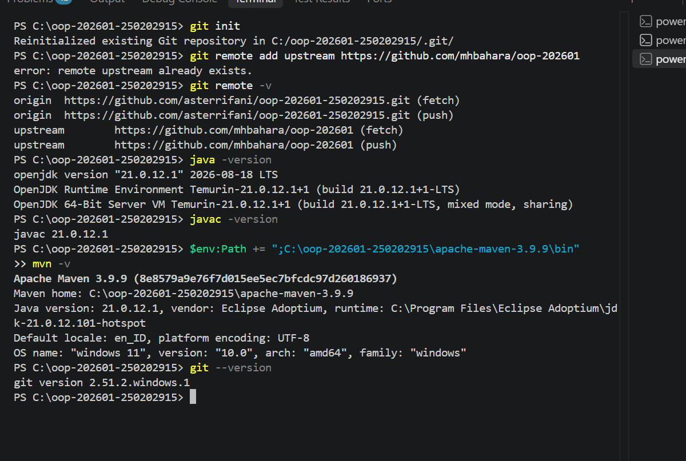

# Catatan Minggu 01: Paradigma Pemrograman dan Setup

Salin berkas ini menjadi `catatan/minggu-NN.md` (NN dua digit, misalnya `minggu-07.md`).

## Yang saya kerjakan
saya mengerjakan dan merapikan kode pada program sapaan aset pinjam meliputi perbedaan paradigma prosedural, OOP, dan functional. Dan mengetest hasil kodingan saya di 'minggu01test.java' dan hasilnya semua benar mengikuti alur program.

## Keputusan desain
saya menggunakan format 

"Hello Aset-Pinjam, saya " + nama + " (" + nim + ")";"

Format keluarannya disamakan pada semua versi, jadi yang berbeda hanya cara membangun programnya: method statis untuk prosedural, field private untuk nama dan NIM pada OOP, dan lambda Function<String, String> untuk functional.

## Kendala
kendala yang saya hadapi yaitu saat menginstal maven, pada saat memanggil perintah 'mvn -version' ini tidak muncul atau eror, dan butuh waktu lama untuk mencari sumber masalahnya

## Penggunaan AI
- Alat yang dipakai: Claude
- Bagian yang dibantu AI: saat menginisialisasi tools pengerjaan dan memahami yang dikerjakan pada minggu ini
- Prompt utama:"Tolong uraikan apa yang akan saya kerjakan minggu ini", "tolong mavennya tidak terbaca padahal sudaah instal"
- Yang saya ubah atau tolak dari saran AI, dan alasannya: tidak ada
- Satu hal yang saya pahami lebih baik sekarang: mengetahui penjelasan dari paradigma prosedural, oop, dan functional.

## Dokumentasi

